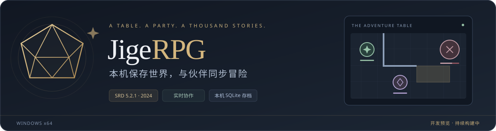
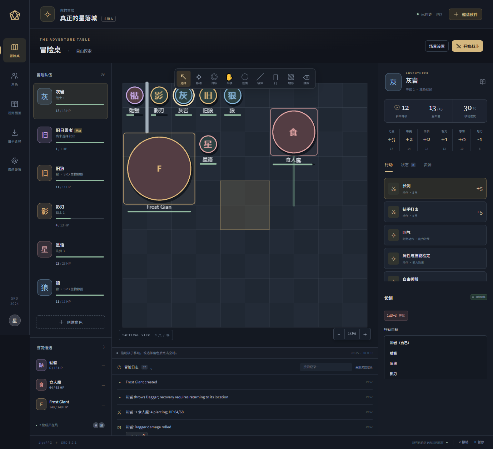
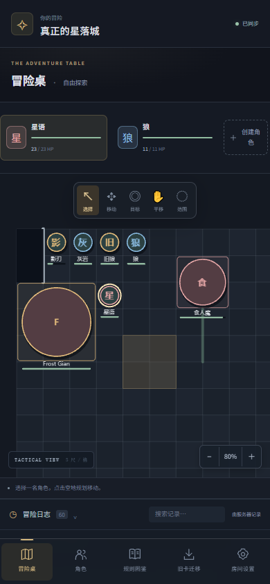

<div align="center">



**中文桌面 / 手机冒险桌 · D&D 2024 / SRD 5.2.1 · Windows x64**

[快速开始](#开始试跑) · [房主与玩家指南](docs/QUICK_START.md) · [备份与恢复](docs/BACKUP.md) · [已知问题](docs/KNOWN_ISSUES.md)

</div>

> [!WARNING]
> **这是可运行的开发版，完整 SRD 自动化尚未完成。** 当前已修复地图背景加载、头像棋子、表单反馈和建卡缺项导航；新增自制卡能力仍待规划。请先用虚构战役试跑，重要存档先备份。使用边界和故障处理见[已知问题与修复记录](docs/KNOWN_ISSUES.md)。

JigeRPG 把主持人、角色、战术地图和行动记录放在同一张桌上。数据保存在房主电脑，通过临时公网链接邀请伙伴；玩家用电脑或手机浏览器加入。

已接通的行动由服务器投骰、校验资源并统一结算。图鉴为条目标注「自动结算 / 需要选择 / 主持人裁定 / 尚未自动化」，方便在使用前判断能力边界。

## 看看冒险桌



<div align="center">
  
  <p><sub>以上为自动化验收使用的虚构战役与角色，不包含用户真实战役或存档。</sub></p>
</div>

| 一张桌上的工具 | 当前能力 |
| --- | --- |
| 角色与成长 | SRD 建卡、标准数组 / 27 点购点、职业与多职业、起始装备、资源和法术选择 |
| 行动与记录 | 已实现的攻击、伤害类型、抗性、资源、反应和主持人裁定；结果进入事件日志 |
| 二维战术地图 | 网格移动、大体型占格、墙、门、地形和部分视野过滤；完整视觉规则仍待补齐 |
| 联机与保存 | 服务器权威状态、恢复码、版本冲突复核、SQLite 存档、战役导出与数据库备份 |

## 开始试跑

### 1. 下载并解压

在 GitHub 选择 **Code → Download ZIP**，解压到自己的文件夹，例如 `D:\Games\JigeRPG`。请在解压后的目录运行，不要直接从压缩包内打开程序。

当前启动器支持 **Windows x64**。首次安装需要联网下载项目私有 Node 26、锁定依赖与 Cloudflare 隧道程序，然后构建页面。无需预装 Node，也不会替换系统 Node；后续运行仍依赖这些本机组件，环境修复和依赖更新也需要联网。

### 2. 房主双击启动

双击根目录的 **`启动JigeRPG.cmd`**，保持启动窗口打开，等待安装、构建和网址输出。浏览器会自动打开本机房主页面。

选择「本机开房」，填写冒险名称和自己的称呼，创建后**保存个人恢复码**。房主的专用启动链接含主机凭据，请通过页面的「邀请伙伴」分享玩家链接。

### 3. 玩家从另一个浏览器加入

默认启动会尝试建立临时公网隧道。房主等待公网地址就绪，再使用「邀请伙伴」分享邀请链接或二维码；玩家输入称呼加入，并保存自己的恢复码。

在同一台电脑测试时，请使用 **Chrome + Edge**，或**普通窗口 + 无痕窗口**。两个普通标签页通常共享同一身份 Cookie，不适合分别扮演房主和玩家。

### 4. 建一张卡，试一次行动

玩家创建角色；房主从规则图鉴加入一个怪物。玩家在背包穿戴武器，再在冒险桌选择角色、行动与目标，提交给服务器结算。第一次可按[一步一步的试跑示例](docs/QUICK_START.md)操作。

房主电脑和启动进程需要保持运行。重启后临时公网地址可能变化；重新分享新地址，成员使用各自恢复码找回原身份与角色。公网隧道不可用时，本机服务仍可使用。

### 常用启动方式

在仓库根目录打开 PowerShell：

```powershell
# 只在本机使用，不建立公网隧道
.\启动JigeRPG.cmd -LocalOnly

# 端口冲突时换一个端口
.\启动JigeRPG.cmd -Port 8123

# 修复依赖或下载环境；先关闭正在运行的房主进程
.\安装或修复环境.cmd

# 开发者运行浏览器测试前，额外安装 Chromium
.\安装或修复环境.cmd -Browsers
```

首次安装失败时保留窗口中的错误信息，检查网络后重试。`-LocalOnly` 也需要先安装 Node 和依赖；它只关闭公网隧道。

## 数据由房主保管

| 位置 / 文件 | 用途 | 是否进入 Git |
| --- | --- | --- |
| `data/` | 默认战役数据库、成员身份和服务器运行数据 | 否 |
| `data/backups/` | 数据库一致性备份及配套清单 | 否 |
| `.tools/` | 项目私有运行时和下载工具 | 否 |
| `node_modules/`、`dist/` | 安装依赖与构建结果 | 否 |
| 自行下载的战役 JSON、恢复码 | 个人备份与身份凭据，需另行妥善保管 | 不应上传 |

这些运行目录由 [.gitignore](.gitignore) 排除。**Git 保存代码，不保存你的战役；恢复代码也不会恢复数据库。** 请把存档备份到项目目录之外，且不要把 `data/`、恢复码或私人备份上传到公开仓库。

主持人可在「房间设置」导出当前冒险。需要保护整个主机的所有战役和身份时，使用完整数据库备份；恢复前先关闭房主进程，并保留 `.sqlite` 与 `.manifest.json` 配套文件。完整步骤见[备份与恢复](docs/BACKUP.md)。

## 旧卡如何带过来

「旧卡迁移」支持导入旧 JSON，或只读导出**当前网址**原有的旧浏览器存储，再复制成新规则草稿。保留原始文件，查看迁移报告，补齐 SRD 建卡选择后再启用。

旧 MP、自制成长和没有明确对应的机制不会直接作为新规则执行。不同域名、`localhost` / `127.0.0.1`、不同端口的浏览器存储相互独立；新版不能直接读取另一个网址的旧数据，需要先从原地址导出。

本次发布只包含当前应用。原始旧版源码保留在 Git 历史和本地基线检查点，未随新目录附带旧版页面或构建脚本。

## 当前完成到哪里

- 已有规则、真实多客户端、联机恢复与浏览器交互测试。实际结果以当前代码的复验记录及 CI 运行结果为准；测试数量不等于规则完成率。
- 覆盖矩阵当前包含 **2017 个目录条目，其中 662 个为 `unsupported`**。这是待实现或待适配的目录状态，**不是“发现了 662 个 bug”**，也不能按目录数量计算完整 SRD 的完成比例。
- 自制角色规则、多项复杂法术与能力、完整视野和多场景等仍需继续设计与实现。开发状态见 [DEVELOPMENT_STATUS.md](DEVELOPMENT_STATUS.md)，逐条边界见 [reference/automation-coverage.json](reference/automation-coverage.json)。

最近的界面修复包括：场景图片预览与清除、角色头像地图棋子、弹窗内的错误与待处理操作、可点击的建卡缺项清单，以及职业与子职联动。规则覆盖缺口与新增自制卡范围保持单独标注。

## 开发与验证

项目根目录包含 `package.json`、`src/`、`scripts/`、`tests/`、`reference/` 和 `runtime.json`。所有命令均在仓库根执行。

完成环境安装后，在当前 PowerShell 会话使用项目私有 Node：

```powershell
$runtime = Get-Content .\runtime.json -Raw | ConvertFrom-Json
$nodeDir = Join-Path $PWD ('.tools\node-v' + $runtime.node.version + '-win-x64')
$env:PATH = $nodeDir + ';' + $env:PATH

npm test
npm run build
# 浏览器测试需先运行：.\安装或修复环境.cmd -Browsers
npm run test:e2e
```

依赖与下载校验值以 `package-lock.json`、[runtime.json](runtime.json) 为准。API 见 [API.md](API.md)，内容来源与署名见 [src/content/README.md](src/content/README.md)。运行公网或回退验收脚本前，阅读其说明并使用隔离测试数据。

## 规则内容与许可

This work includes material from the System Reference Document 5.2.1 (“SRD 5.2.1”) by Wizards of the Coast LLC, available at https://www.dndbeyond.com/srd. The SRD 5.2.1 is licensed under the Creative Commons Attribution 4.0 International License, available at https://creativecommons.org/licenses/by/4.0/legalcode.

结构化内容来自固定版本的 5e-bits 2024 SRD 数据，保留其[上游许可](src/content/raw/UPSTREAM-LICENSE.md)。中文界面、数据结构化和自动化实现为本项目改编；本项目不是 Wizards of the Coast 官方产品。第三方组件及规则署名也可在正式页面的「规则来源与许可」中查看。
