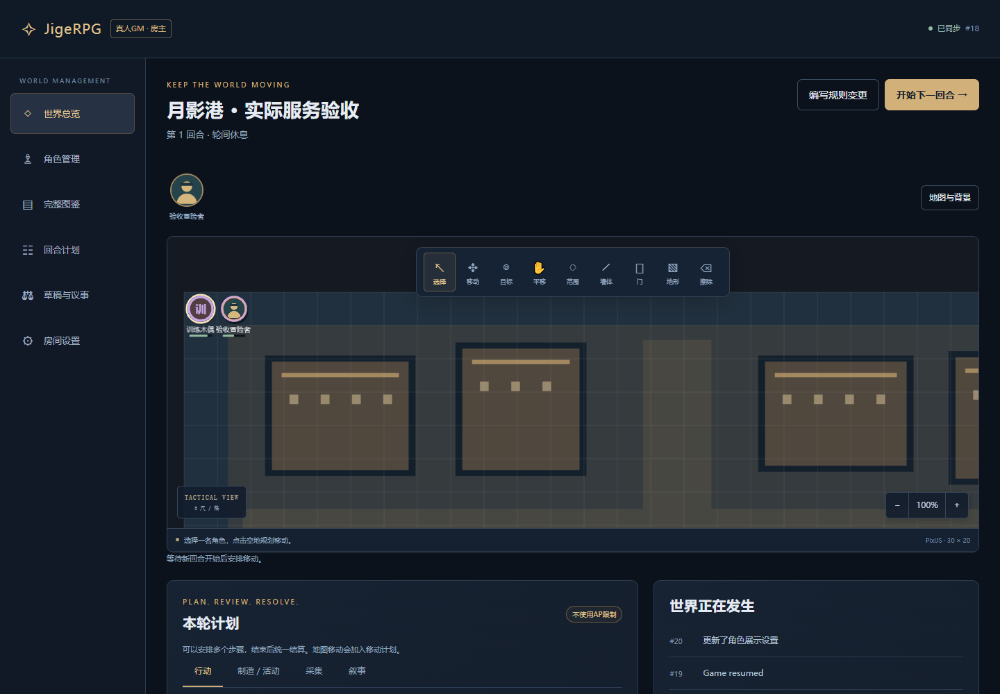
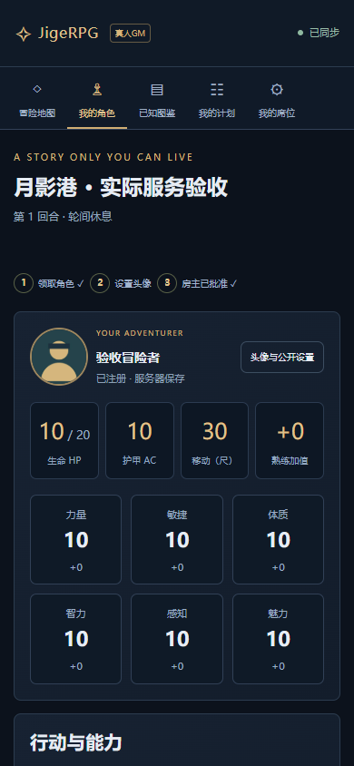

<div align="center">


**你的世界，一起发生。**

中文桌面 / 手机冒险桌 · 真人 GM / AI 主持 / 自由共创 · Windows x64

[快速开始](#开始试跑) · [房主与玩家指南](docs/QUICK_START.md) · [世界规则](docs/WORLD_MODES.md) · [AI 交换协议](docs/AI_PROTOCOL.md) · [备份与恢复](docs/BACKUP.md)

</div>

> [!NOTE]
> **2.0 开发预览：先建立世界，再邀请伙伴。** 默认一键自由卡，标准 2024 建卡仍保留为 GM 高级入口。AI 采用手动 JSON 交换，需要房主预览并确认。完整 SRD 自动化仍在建设，使用范围见[当前边界](docs/KNOWN_ISSUES.md)。

JigeRPG 把主持人、角色、战术地图和行动记录放在同一张桌上。数据保存在房主电脑，通过临时公网链接邀请伙伴；玩家用电脑或手机浏览器加入。

房主创建角色、调整规则；玩家领取一张卡、设置头像，进入属于自己的冒险界面。地图、图片、角色和已确认操作保存在房主电脑。图鉴逐人解锁，其他人的详细资料只有在本人选择公开后才显示。

## 看看冒险桌



<div align="center">
  
  <p><sub>以上为自动化验收使用的虚构战役与角色，不包含用户真实战役或存档。</sub></p>
</div>

| 一张桌上的工具 | 当前能力 |
| --- | --- |
| 三种世界 | 真人 GM 单条审批行动；AI 手动整轮决策；自由共创统一回合与提案治理 |
| 自由角色 | 默认 HP 10、六维 10；HP / MP / 体力 / 护盾 / 技能可配置；标准卡可保留原卡并复制 |
| 治理与权限 | 民主投票、可选房主否决；独裁审批、按事项授权和随时收回 |
| 行动力与成长 | 小时或在线回合恢复、独立回合支出额度、六位小数、成长曲线和分项经验 |
| 地图与头像 | 上传地图图片、头像棋子、墙门地形、范围模板；服务端验证移动及目标 |
| 联机与保存 | 逐人可见信息、恢复码、幂等操作、SQLite、图片随完整备份导出 |

## 开始试跑

### 1. 下载并解压

在 GitHub 选择 **Code → Download ZIP**，解压到自己的文件夹，例如 `D:\Games\JigeRPG`。请在解压后的目录运行，不要直接从压缩包内打开程序。

当前启动器支持 **Windows x64**。首次安装需要联网下载项目私有 Node 26、锁定依赖与 Cloudflare 隧道程序，然后构建页面。无需预装 Node，也不会替换系统 Node；后续运行仍依赖这些本机组件，环境修复和依赖更新也需要联网。

### 2. 房主双击启动

双击根目录的 **`启动JigeRPG.cmd`**，保持启动窗口打开，等待安装、构建和网址输出。浏览器会自动打开本机房主页面。

选择「本机开房」，填写世界名称和自己的称呼，选择 **真人 GM、AI 主持或自由共创**。自由共创还需选择民主 / 独裁；民主可开启房主否决权。开房后模式与治理方式锁定。创建后保存个人恢复码，使用「邀请伙伴」分享玩家链接。

### 3. 玩家从另一个浏览器加入

默认启动会尝试建立临时公网隧道。房主等待公网地址就绪，再使用「邀请伙伴」分享邀请链接或二维码；玩家输入称呼加入，并保存自己的恢复码。

在同一台电脑测试时，请使用 **Chrome + Edge**，或**普通窗口 + 无痕窗口**。两个普通标签页通常共享同一身份 Cookie，不适合分别扮演房主和玩家。

### 4. 领取一张卡，试一次行动

房主进入「角色管理」，点「创建默认角色」即可得到空白卡，按需给予数值和技能。玩家在「我的角色」申请领取，上传头像；房主批准注册后即可使用。玩家只看到自己的完整卡、已解锁图鉴和对方主动公开的资料。

房主配置好世界后开始回合。真人 GM 审批行动；AI 模式由房主在工作台导出 JSON 给 ChatGPT，再预览、确认导入；自由共创由玩家规划、结束回合，房主统一结算，世界改动再按投票或授权审批采用。详见[一步一步试跑](docs/QUICK_START.md)。

房主电脑和启动进程需要保持运行。重启后临时公网地址可能变化；重新分享新地址，成员使用各自恢复码找回原身份与角色。公网隧道不可用时，本机服务仍可使用。

### 常用启动方式

在仓库根目录打开 PowerShell：

```powershell
# 只在本机使用，不建立公网隧道
.\启动JigeRPG.cmd -LocalOnly

# 端口冲突时换一个端口
.\启动JigeRPG.cmd -Port 8123

# 修复依赖或下载环境；先关闭正在运行的房主进程
.\安装或修复环境.cmd

# 开发者运行浏览器测试前，额外安装 Chromium
.\安装或修复环境.cmd -Browsers
```

首次安装失败时保留窗口中的错误信息，检查网络后重试。`-LocalOnly` 也需要先安装 Node 和依赖；它只关闭公网隧道。

## 数据由房主保管

| 位置 / 文件 | 用途 | 是否进入 Git |
| --- | --- | --- |
| `data/` | 默认战役数据库、成员身份和服务器运行数据 | 否 |
| `data/backups/` | 数据库一致性备份及配套清单 | 否 |
| `.tools/` | 项目私有运行时和下载工具 | 否 |
| `node_modules/`、`dist/` | 安装依赖与构建结果 | 否 |
| 自行下载的战役 JSON、恢复码 | 个人备份与身份凭据，需另行妥善保管 | 不应上传 |

这些运行目录由 [.gitignore](.gitignore) 排除。**Git 保存代码，不保存你的战役；恢复代码也不会恢复数据库。** 请把存档备份到项目目录之外，且不要把 `data/`、恢复码或私人备份上传到公开仓库。

主持人可在「房间设置」导出当前冒险。需要保护整个主机的所有战役和身份时，使用完整数据库备份；恢复前先关闭房主进程，并保留 `.sqlite` 与 `.manifest.json` 配套文件。完整步骤见[备份与恢复](docs/BACKUP.md)。

## 旧卡如何带过来

房主可在「房间设置」导入旧 JSON。迁移只复制；原始文件保留，源指纹防止同一存档重复导入。旧标准卡还可「复制为自由卡」，新卡使用新 ID，原卡保留。

法术位保留为法术位，不猜成 MP；无法等价转换的成长和跨角色效果写入迁移报告，由房主复核。不同域名、`localhost` / `127.0.0.1`、不同端口的旧浏览器存储相互独立，需要先从原网址导出。

本次发布只包含当前应用。原始旧版源码保留在 Git 历史和本地基线检查点，未随新目录附带旧版页面或构建脚本。

## 当前完成到哪里

- 已有规则、真实多客户端、联机恢复与浏览器交互测试。实际结果以当前代码的复验记录及 CI 运行结果为准；测试数量不等于规则完成率。
- 覆盖矩阵当前包含 **2017 个目录条目，其中 662 个为 `unsupported`**。这是待实现或待适配的目录状态，**不是“发现了 662 个 bug”**，也不能按目录数量计算完整 SRD 的完成比例。
- 自由卡和三模式已建立独立流程；复杂 SRD 法术与能力、完整照明 / 特殊感官 / 垂直空间 / 多场景仍有缺口。开发状态见 [DEVELOPMENT_STATUS.md](DEVELOPMENT_STATUS.md)，逐条边界见 [reference/automation-coverage.json](reference/automation-coverage.json)。

AI 工作台不自动调用模型，也不需要绑定某家 API。模型提出的裁定始终经房主确认；程序骰与 AI 骰均保留来源和实际骰面。提案不是即时改写世界，通过后在下一回合应用，失败会保留原草稿与冲突原因。

## 开发与验证

项目根目录包含 `package.json`、`src/`、`scripts/`、`tests/`、`reference/` 和 `runtime.json`。所有命令均在仓库根执行。

完成环境安装后，在当前 PowerShell 会话使用项目私有 Node：

```powershell
$runtime = Get-Content .\runtime.json -Raw | ConvertFrom-Json
$nodeDir = Join-Path $PWD ('.tools\node-v' + $runtime.node.version + '-win-x64')
$env:PATH = $nodeDir + ';' + $env:PATH

npm test
npm run build
# 浏览器测试需先运行：.\安装或修复环境.cmd -Browsers
npm run test:e2e
```

依赖与下载校验值以 `package-lock.json`、[runtime.json](runtime.json) 为准。API 见 [API.md](API.md)，内容来源与署名见 [src/content/README.md](src/content/README.md)。运行公网或回退验收脚本前，阅读其说明并使用隔离测试数据。

## 规则内容与许可

This work includes material from the System Reference Document 5.2.1 (“SRD 5.2.1”) by Wizards of the Coast LLC, available at https://www.dndbeyond.com/srd. The SRD 5.2.1 is licensed under the Creative Commons Attribution 4.0 International License, available at https://creativecommons.org/licenses/by/4.0/legalcode.

结构化内容来自固定版本的 5e-bits 2024 SRD 数据，保留其[上游许可](src/content/raw/UPSTREAM-LICENSE.md)。中文界面、数据结构化和自动化实现为本项目改编；本项目不是 Wizards of the Coast 官方产品。第三方组件及规则署名也可在正式页面的「规则来源与许可」中查看。
