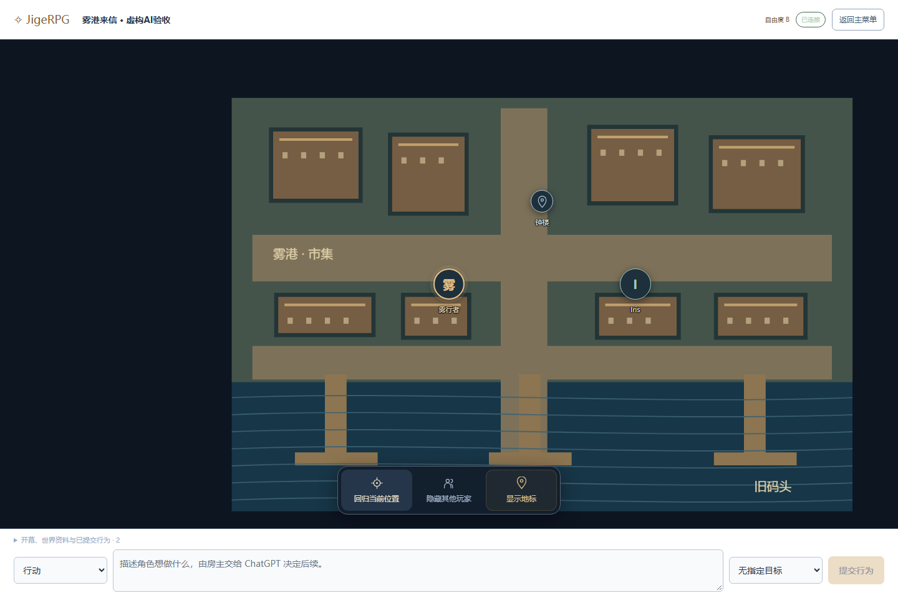
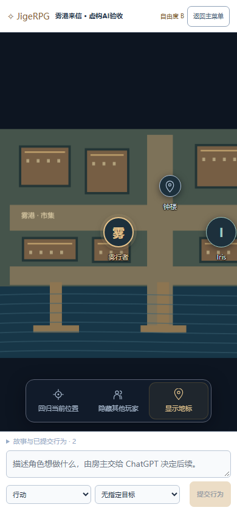

<div align="center">


**你的世界，一起发生。**

中文桌面 / 手机冒险桌 · 真人 GM / AI 主持 / 自由共创 · Windows x64

[快速开始](#开始试跑) · [AI 世界指南](docs/AI_DISPLAY_V2.md) · [开发交接](HANDOFF.md) · [备份与恢复](docs/BACKUP.md) · [验收记录](docs/VERIFICATION.md)

</div>

> [!NOTE]
> **2.0 beta.2：一个账号，多个世界。** 登录后选择「开始 / 新建 / 基础设置」。本轮重点是 **DND → AI 通过 JSON 主持**：AI 提供游戏数值和剧情，程序负责展示、权限与可靠保存。完整 SRD 自动化与其他模式的后续范围见[开发交接](HANDOFF.md)。

JigeRPG 把主持人、角色、战术地图和行动记录放在同一张桌上。数据保存在房主电脑，通过临时公网链接邀请伙伴；玩家用电脑或手机浏览器加入。

房主把模组与程序生成的提示词交给 ChatGPT，再导入初始化 JSON。玩家选择角色后直接进入地图，点击头像查看资料或更换图片。AI 提供的角色、世界观与开场会显示在页面中；私密资料由服务器按角色分发。

## 看看 AI 冒险地图



<div align="center">
  
  <p><sub>以上为自动化验收使用的虚构战役与角色，不包含用户真实战役或存档。</sub></p>
</div>

[查看账号主页：开始 / 新建 / 基础设置](docs/screenshots/account-home.png)

| 一张桌上的工具 | 当前能力 |
| --- | --- |
| 账号与世界 | 本机账号密码；有权加入的世界列表；世界切换保留角色身份 |
| 两类入口 | DND：真人 GM / AI JSON；自由：独裁 / 民主，可选房主否决 |
| AI 主持 | 2014 / 2024 版元数据，五组初始化内容，自由度 A / B / C，后续 JSON 增量更新 |
| 自由角色 | 默认 HP 10、六维 10；HP / MP / 体力 / 护盾 / 技能可配置；标准卡可保留原卡并复制 |
| 治理与权限 | 民主投票、可选房主否决；独裁审批、按事项授权和随时收回 |
| 行动力与成长 | 小时或在线回合恢复、独立回合支出额度、六位小数、成长曲线和分项经验 |
| AI 地图与头像 | 上传地图、固定屏幕大小头像、回归当前位置、隐藏其他玩家、已公开地标 |
| 联机与保存 | 逐人可见信息、恢复码、幂等操作、SQLite、图片随完整备份导出 |

## 开始试跑

### 1. 下载并解压

在 GitHub 选择 **Code → Download ZIP**，解压到自己的文件夹，例如 `D:\Games\JigeRPG`。请在解压后的目录运行，不要直接从压缩包内打开程序。

当前启动器支持 **Windows x64**。首次安装需要联网下载项目私有 Node 26、锁定依赖与 Cloudflare 隧道程序，然后构建页面。无需预装 Node，也不会替换系统 Node；后续运行仍依赖这些本机组件，环境修复和依赖更新也需要联网。

### 2. 房主双击启动

双击根目录的 **`启动JigeRPG.cmd`**，保持启动窗口打开，等待安装、构建和网址输出。浏览器会自动打开本机房主页面。

在启动器打开的本机地址注册或登录账号。登录后点「新建」，先选 **DND / 自由模式**，再选真人 / AI 主持，或独裁 / 民主。AI 世界还要选择 A / B / C 自由度，按页面提示导入模组初始化 JSON。模式由房主在新建时决定。

### 3. 玩家从另一个浏览器加入

默认启动会尝试建立临时公网隧道。房主等待公网地址就绪，使用世界内原有的「邀请伙伴」分享链接或二维码；玩家登录自己的账号后加入。链接先于登录打开也可以，登录后继续加入目标世界。

在同一台电脑测试时，请使用 **Chrome + Edge**，或**普通窗口 + 无痕窗口**。两个普通标签页通常共享同一身份 Cookie，不适合分别扮演房主和玩家。

### 4. 领取一张卡，试一次行动

在新 AI 世界中，玩家从 AI 导入的候选角色里选择一人，不需要再完成标准建卡清单。选择后进入地图；没有地图图片时显示空白背景和自己的头像。角色行为由服务器绑定身份后导出为 JSON，由房主交给 AI，再导入 AI 的结果。

AI 数值按原值呈现，例如生命为 0、负数或超过上限都不会被程序重新计算。程序仍校验 JSON 格式、字符与体积限制、真实身份、可见范围和版本冲突。A 模式的 AI 补充字段等待房主逐项接受或留空，B / C 不要求逐项确认。详见[AI 世界指南](docs/AI_DISPLAY_V2.md)。

房主电脑和启动进程需要保持运行。重启后临时公网地址可能变化；重新分享新地址，使用同一个账号登录即可返回原世界。旧版恢复码用于关联尚未绑定账号的旧成员。公网隧道不可用时，本机服务仍可使用。

### 常用启动方式

在仓库根目录打开 PowerShell：

```powershell
# 只在本机使用，不建立公网隧道
.\启动JigeRPG.cmd -LocalOnly

# 端口冲突时换一个端口
.\启动JigeRPG.cmd -Port 8123

# 修复依赖或下载环境；先关闭正在运行的房主进程
.\安装或修复环境.cmd

# 开发者运行浏览器测试前，额外安装 Chromium
.\安装或修复环境.cmd -Browsers
```

首次安装失败时保留窗口中的错误信息，检查网络后重试。`-LocalOnly` 也需要先安装 Node 和依赖；它只关闭公网隧道。

## 数据由房主保管

| 位置 / 文件 | 用途 | 是否进入 Git |
| --- | --- | --- |
| `data/` | 默认战役数据库、成员身份和服务器运行数据 | 否 |
| `data/backups/` | 数据库一致性备份及配套清单 | 否 |
| `.tools/` | 项目私有运行时和下载工具 | 否 |
| `node_modules/`、`dist/` | 安装依赖与构建结果 | 否 |
| 自行下载的战役 JSON、恢复码 | 个人备份与身份凭据，需另行妥善保管 | 不应上传 |

这些运行目录由 [.gitignore](.gitignore) 排除。**Git 保存代码，不保存你的战役；恢复代码也不会恢复数据库。** 请把存档备份到项目目录之外，且不要把 `data/`、恢复码或私人备份上传到公开仓库。

主持人可在「房间设置」导出当前冒险。需要保护整个主机的所有战役和身份时，使用完整数据库备份；恢复前先关闭房主进程，并保留 `.sqlite` 与 `.manifest.json` 配套文件。完整步骤见[备份与恢复](docs/BACKUP.md)。

## 旧卡如何带过来

房主可在「房间设置」导入旧 JSON。迁移只复制；原始文件保留，源指纹防止同一存档重复导入。旧标准卡还可「复制为自由卡」，新卡使用新 ID，原卡保留。

法术位保留为法术位，不猜成 MP；无法等价转换的成长和跨角色效果写入迁移报告，由房主复核。不同域名、`localhost` / `127.0.0.1`、不同端口的旧浏览器存储相互独立，需要先从原网址导出。

本次发布只包含当前应用。原始旧版源码保留在 Git 历史和本地基线检查点，未随新目录附带旧版页面或构建脚本。

## 当前完成到哪里

- 已有规则、真实多客户端、联机恢复与浏览器交互测试。实际结果以当前代码的复验记录及 CI 运行结果为准；测试数量不等于规则完成率。
- 覆盖矩阵当前包含 **2017 个目录条目，其中 662 个为 `unsupported`**。这是待实现或待适配的目录状态，**不是“发现了 662 个 bug”**，也不能按目录数量计算完整 SRD 的完成比例。
- 自由卡和三模式已建立独立流程；复杂 SRD 法术与能力、完整照明 / 特殊感官 / 垂直空间 / 多场景仍有缺口。开发状态见 [DEVELOPMENT_STATUS.md](DEVELOPMENT_STATUS.md)，逐条边界见 [reference/automation-coverage.json](reference/automation-coverage.json)。

AI 工作台采用手动 JSON 往返，不需要 API Key。玩家不能直接修改主持提示词或导入结果；其文本作为不可信的角色意图交给 AI。隐藏剧情和他人私密资料由服务端过滤，提示词也要求拒绝越权索要答案；这不保证外部 AI 永远不会误判。程序骰只提供骰面，最终结果由 AI 决定。旧协议 v1 和非 AI 模式保留原有机制，不能混用为 v2 展示协议。

## 开发与验证

项目根目录包含 `package.json`、`src/`、`scripts/`、`tests/`、`reference/` 和 `runtime.json`。所有命令均在仓库根执行。

完成环境安装后，在当前 PowerShell 会话使用项目私有 Node：

```powershell
$runtime = Get-Content .\runtime.json -Raw | ConvertFrom-Json
$nodeDir = Join-Path $PWD ('.tools\node-v' + $runtime.node.version + '-win-x64')
$env:PATH = $nodeDir + ';' + $env:PATH

npm test
npm run build
# 浏览器测试需先运行：.\安装或修复环境.cmd -Browsers
npm run test:e2e
```

依赖与下载校验值以 `package-lock.json`、[runtime.json](runtime.json) 为准。API 见 [API.md](API.md)，内容来源与署名见 [src/content/README.md](src/content/README.md)。运行公网或回退验收脚本前，阅读其说明并使用隔离测试数据。

## 规则内容与许可

This work includes material from the System Reference Document 5.2.1 (“SRD 5.2.1”) by Wizards of the Coast LLC, available at https://www.dndbeyond.com/srd. The SRD 5.2.1 is licensed under the Creative Commons Attribution 4.0 International License, available at https://creativecommons.org/licenses/by/4.0/legalcode.

结构化内容来自固定版本的 5e-bits 2024 SRD 数据，保留其[上游许可](src/content/raw/UPSTREAM-LICENSE.md)。中文界面、数据结构化和自动化实现为本项目改编；本项目不是 Wizards of the Coast 官方产品。第三方组件及规则署名也可在正式页面的「规则来源与许可」中查看。
