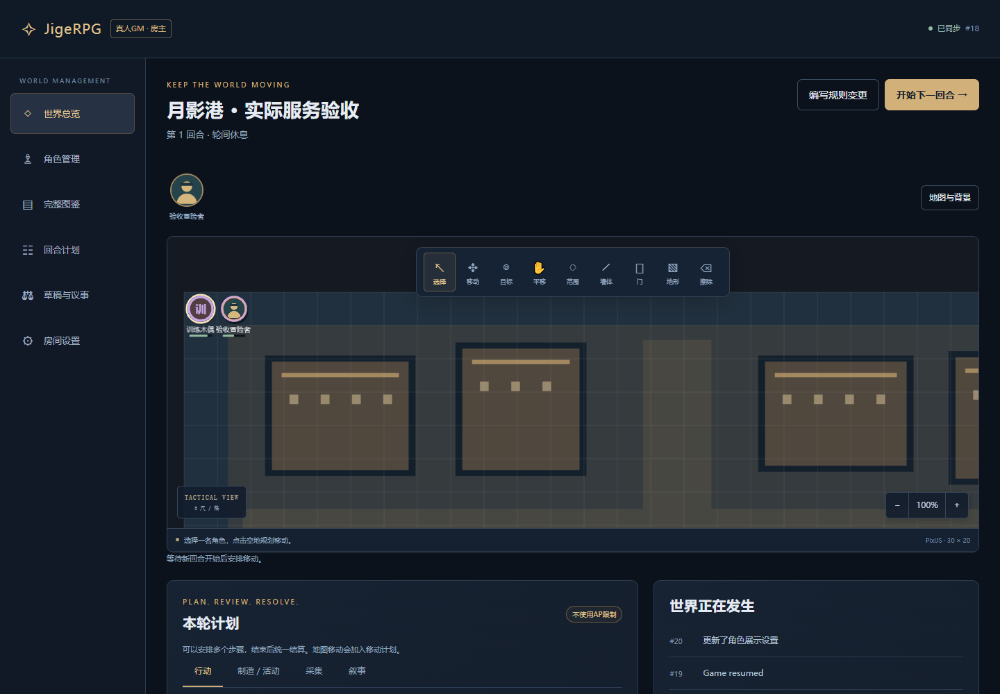
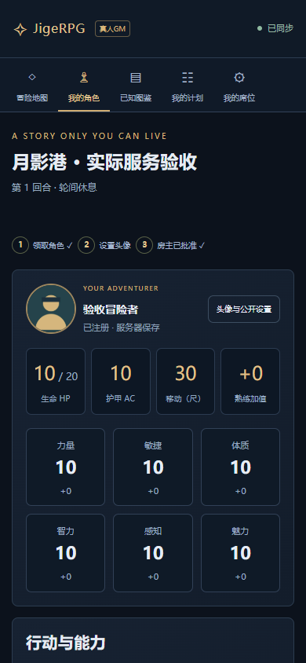

# 第一次和朋友试跑

[← 返回项目首页](../README.md)

这是当前开发版的最短体验流程。先使用虚构战役与角色，查看[已知问题](KNOWN_ISSUES.md)，并保留恢复码。已有重要存档时先做[备份](BACKUP.md)。

## 房主：开一张桌

1. 完整解压项目，双击根目录 `启动JigeRPG.cmd`。首次安装需要联网；等待启动窗口完成下载、依赖安装与页面构建。
2. 使用本机专用页面，选择「本机开房」，填写世界名和称呼，选择真人 GM / AI 主持 / 自由共创。自由共创再选择民主 / 独裁，民主可开启房主否决；创建后模式与治理方式锁定。
3. 创建后复制或下载**房主个人恢复码**。它用于找回身份，应像密码一样保管。
4. 等待公网地址就绪，在「邀请伙伴」中复制玩家邀请链接或分享二维码。不要分享含 `hostToken` 的本机专用启动链接。

房主的启动窗口需要一直运行。若隧道连接失败，可以先用本机页面试跑；也可关闭后以 `启动JigeRPG.cmd -LocalOnly` 启动。

## 玩家：从另一个浏览器入座

玩家直接打开房主的邀请链接，用电脑或手机浏览器即可，不需要下载此项目。填写自己的称呼加入，保存**玩家自己的恢复码**。

如果房主和玩家在同一台电脑测试，使用以下任一种方式：

- 房主用 Chrome，玩家用 Edge。
- 房主用普通窗口，玩家用无痕窗口。

不要用同一浏览器的两个普通标签页分别登录两种身份，它们通常共用 Cookie。无痕窗口关闭后可能清除会话，请先保存恢复码。

## 房主建卡，玩家领取

房主进入「角色管理」，玩家进入「我的角色」，两者使用不同的工作界面。

1. 房主点「创建默认角色」。默认生命 10、六维 10、AC 10、速度 30，不选职业、物种或背景也能建立。
2. 房主点「编辑全部数值」，按需设置生命、MP、体力、护盾、属性与技能，也可保留默认值。标准 2024 规则建卡位于「标准5e（高级）」入口。
3. 玩家申请一个候选角色，在「头像 / 公开」中设置自己的头像；房主批准注册。每人一个注册主角，随从和 NPC 不额外占投票席位。
4. 注册后玩家看到自己的完整卡与已解锁图鉴。点击其他玩家头像，只显示对方选择公开的故事、数值、技能或装备分组，默认只显示姓名和头像。

建卡弹窗会列出缺项；点击一项即可跳到对应步骤与字段，也可以使用「上一步 / 下一步」。服务器错误和待处理操作会显示在弹窗内。保存失败时按提示修改；离线或版本冲突请先复核，详见[表单报错与待处理操作](KNOWN_ISSUES.md#表单报错与待处理操作)。尚未完成的草稿不会参与自动战斗。

自由卡无需花完属性点；背景加点限制仅适用于选择了标准规则的卡。头像保存后用于角色卡与地图棋子，加载失败保留名字首字。标准卡可以保留原卡并复制为自由卡，迁移报告会列出需要复核的差异。

房主可在冒险桌点击「场景设置」，上传背景图片，确认预览后点击「保存场景」。图片会铺满所设置的网格；可用「清除背景」回到默认网格。手机也提供相同入口。

## 房主与玩家：试一次行动

1. 房主准备地图、角色和可用技能，在房间设置中配置本世界规则，再开始世界。
2. 玩家在地图规划移动，或在「我的计划」选择行动、目标及范围原点。自由共创先保留本轮额度，尚未扣费。
3. 真人 GM 模式由房主单独批准 / 拒绝各条意图。AI 主持由玩家规划并结束回合，房主在 AI 工作台导出上下文、交给 ChatGPT，再预览并确认返回 JSON。自由共创由在线成员结束回合后，房主确认统一结算。
4. 查看行动结果、资源和事件记录。有反应选择时先由对应玩家选择；AI 骰不足则等待房主补充，不会自动改用程序骰。

规则目录标为「尚未自动化」的确定性能力会被阻止。自由技能按显式配置执行，不用通用伤害公式代替未实现的规则。AI 的初始化、骰源及反应补骰见 [AI 交换协议](AI_PROTOCOL.md)。

## 自由世界：提交一份提案

1. 房主在初创时设置行动力、每回合支出额度、恢复方式、提案费用和投票时限。配置留空时，依赖该项的操作会解释原因，其余操作和草稿仍可使用。
2. 玩家保存地图、NPC、规则或故事草稿，不消耗行动力。未完成的 JSON 也可先保存。
3. 完成内容后提交提案意图，预留本轮额度；回合结算成功才扣费并开票 / 审批。
4. 民主房间按开票时的注册主角名单投票。弃权不计有效票，平票由房主裁定，全部弃权不通过。开启房主否决时，多数通过仍需房主显式批准。
5. 独裁房间由房主或被授予该事项审核权的人审批，房主可随时收回权限。受权人不能转授权。
6. 通过的提案在下一回合应用；投票等待期间其他回合仍可继续。拒绝或应用冲突保留原草稿和原因。

行动力按小时或每回合恢复，二者互斥。小时恢复计算离线时间；每回合恢复只计当前在线已注册玩家及受控随从，自动 NPC 独立恢复。增加上限不会自动回满。完整细节见[世界规则](WORLD_MODES.md)。

## 下次回来

- 房主重新启动应用后，临时公网地址可能变化。请重新分享新邀请地址。
- 老成员在新地址选择「恢复身份」，输入原来的个人恢复码。无需再次创建同名角色。
- 数据保存在房主电脑的 `data/`。不要把删除浏览器数据当作删除战役，也不要把 Git 回退当作数据库恢复。
- 结束前在「房间设置」导出当前冒险，并定期做完整主机备份。

## 测试截图

这些图片仅展示验收场景；不包含用户真实战役、身份凭据或存档。
